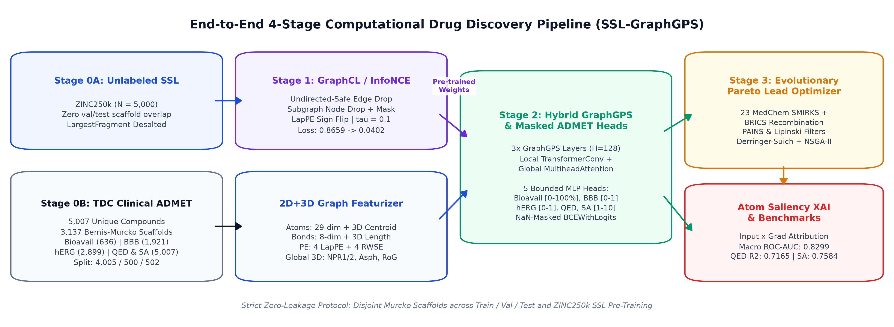
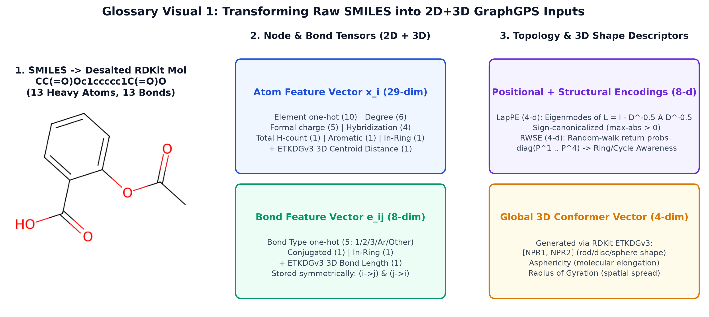
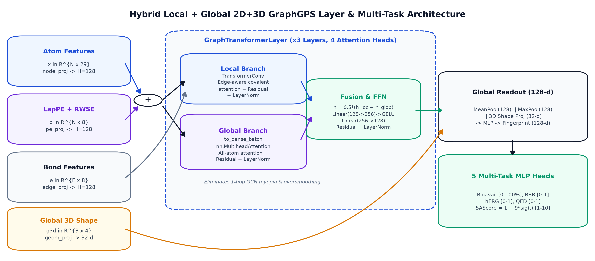
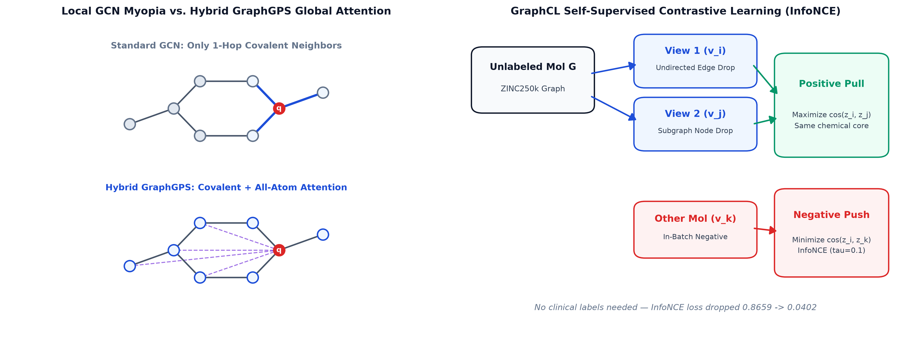
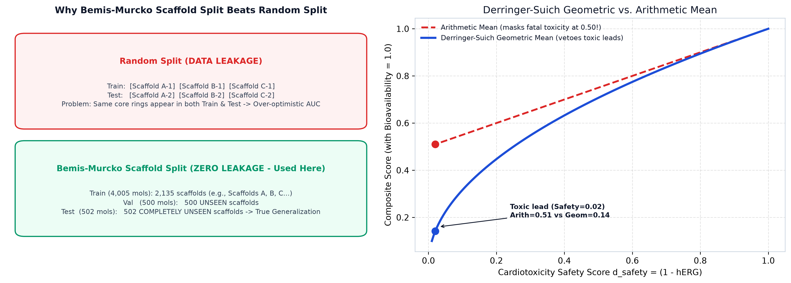
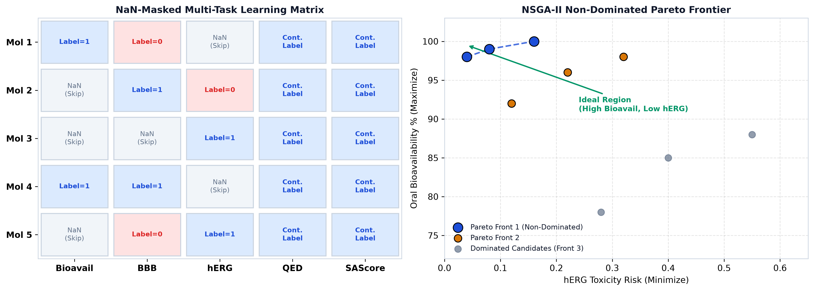

# Project Visual Glossary & Complete Terminology Handbook

This glossary explains **every pharmacological, chemoinformatics, graph neural network, self-supervised learning, optimization, and explainability term** used across this project—with plain-English intuition, mathematical definitions, visual diagrams, and exact links to where each concept lives in the codebase.

---

## System Overview at a Glance

---

## 1. Pharmacology & Computational Drug Discovery (CADD)

- **ADMET (*Absorption, Distribution, Metabolism, Excretion, and Toxicity*):** The five pharmacokinetic and safety pillars governing whether a chemical compound behaves safely and effectively in the human body. Over 90% of clinical drug candidates fail due to poor ADMET rather than lack of target binding.
- **Human Oral Bioavailability ($F \ge 20\%$):** The fraction of an orally administered pill that survives digestion and first-pass liver metabolism to reach systemic blood circulation. Modeled as a binary classification task (`1` if $F \ge 20\%$, mapped to $[0, 100]\%$) from TDC `Bioavailability_Ma` (`636` compounds). Implemented in [src/models/multi_objective_heads.py](file:///Users/prathmeshtoke/Local/Project/Python/course_project/src/models/multi_objective_heads.py).
- **Blood-Brain Barrier (BBB) Permeability:** The selective endothelial membrane protecting the brain. High BBB+ probability ($\approx 1$) is required for CNS drugs (e.g., Caffeine `0.941`), whereas peripheral drugs (e.g., Aspirin) prefer low BBB penetration to avoid neurological side effects. Trained on TDC `BBB_Martins` (`1,921` compounds).
- **hERG Cardiotoxicity (QT Prolongation):** Inhibition of the cardiac potassium channel encoded by the *human Ether-a-go-go-Related Gene* (hERG), which delays ventricular repolarization and can trigger lethal arrhythmia. Modeled as probability $\in [0, 1]$ across `2,899` merged compounds (`hERG` Wang + `hERG_Karim`).
- **QED (*Quantitative Estimate of Drug-Likeness*):** A continuous score in $[0, 1]$ combining eight physicochemical descriptors (molecular weight, logP, polar surface area, H-bond donors/acceptors, aromatic rings, rotatable bonds, structural alerts) to measure resemblance to known oral drugs (`1.0` = highly drug-like).
- **SAScore (*Synthetic Accessibility Score*):** An empirical complexity score from `1.0` (trivial one-step synthesis, e.g., Aspirin `1.58`) to `10.0` (prohibitively hard to synthesize in a lab), computed via RDKit `SA_Score` and bounded strictly via $1 + 9\sigma(z) \in [1, 10]$ in [src/models/multi_objective_heads.py](file:///Users/prathmeshtoke/Local/Project/Python/course_project/src/models/multi_objective_heads.py).
- **Lipinski's Rule of Five (Ro5):** Classic oral drug-likeness heuristic checking: $\text{MW} \le 500\text{ Da}$, $\log P \le 5$, $\text{HBD} \le 5$, and $\text{HBA} \le 10$. Candidates with $>1$ violation are filtered out during lead optimization in [src/utils/chemistry.py](file:///Users/prathmeshtoke/Local/Project/Python/course_project/src/utils/chemistry.py).
- **PAINS (*Pan-Assay Interference Compounds*):** Reactive or promiscuous chemical substructures (e.g., rhodanines, quinones) that trigger false positives across biological assays. Automatically rejected via RDKit `FilterCatalog` in `compute_lipinski_and_pains`.
- **Pharmacophore:** The minimal 3D spatial arrangement of chemical features (e.g., basic tertiary amine nitrogen near an aromatic ring for hERG channel binding) responsible for a biological interaction.
- **Bioisostere:** A chemical substituent with similar size, electronics, or geometry substituted into a lead molecule to improve safety or absorption without losing target activity (e.g., replacing carboxylic acid `-COOH` with a tetrazole ring or amide in [src/optimization/lead_mutator.py](file:///Users/prathmeshtoke/Local/Project/Python/course_project/src/optimization/lead_mutator.py)).
- **Lead Optimization:** Iterative chemical modification of an initial active molecule ("seed lead", such as Aspirin) to simultaneously maximize bioavailability and drug-likeness while minimizing toxicity and synthesis cost.

---

## 2. Chemoinformatics & Molecular Representations

- **SMILES (*Simplified Molecular Input Line Entry System*):** Compact ASCII text notation encoding atoms and bonds (e.g., Aspirin = `CC(=O)Oc1ccccc1C(=O)O`).
- **Canonical Non-Isomeric SMILES:** A unique deterministic SMILES string for any molecule (`canonical=True, isomericSmiles=False`), ensuring identical molecules never appear under two different spellings across datasets.
- **Desalting (`LargestFragmentChooser`):** Real assay tables often contain counterions or salts (e.g., `.[Cl]`, `.[Na+]`), which create disconnected graph nodes and trivial zero eigenvalues. Standardized out via `standardize_smiles` in [src/utils/chemistry.py](file:///Users/prathmeshtoke/Local/Project/Python/course_project/src/utils/chemistry.py).
- **Bemis-Murcko Scaffold:** The core ring systems plus the linear linker chains connecting them, obtained after stripping all terminal side chains. Used by `get_murcko_scaffold` in [src/utils/splitting.py](file:///Users/prathmeshtoke/Local/Project/Python/course_project/src/utils/splitting.py) to guarantee test molecules have completely unseen cores.
- **Morgan Fingerprints (ECFP4):** A 2048-bit circular binary vector hashing local atom neighborhoods up to radius 2 (diameter 4 bonds). Used both for classical Random Forest baselines (`MorganFingerprintRFBaseline`) and Tanimoto chemical similarity.
- **Tanimoto Similarity:** Set overlap similarity between two molecular bit-vectors $A$ and $B$: $T(A,B) = \frac{|A \cap B|}{|A \cup B|} \in [0, 1]$. Lead optimization enforces $T \ge 0.35$ so evolved analogues retain structural kinship to the seed drug.
- **Reaction SMIRKS:** Machine-readable chemical reaction templates specifying exact bond/atom rewrites (e.g., `[c:1][H]>>[c:1]F` for aromatic fluorination). Expanded to **23 warning-free rules** in [src/optimization/lead_mutator.py](file:///Users/prathmeshtoke/Local/Project/Python/course_project/src/optimization/lead_mutator.py).
- **BRICS (*Breaking of Retrosynthetically Interesting Chemical Substructures*):** Synthetically sensible fragment decomposition and recombination algorithm (`generate_brics_analogues`) that swaps larger molecular building blocks beyond single-atom point edits.
- **ETKDGv3 3D Conformers & Shape Descriptors (`NPR1`, `NPR2`, `Asphericity`, `RadiusOfGyration`):** RDKit's Experimental-Torsion-angle Knowledge Distance Geometry algorithm generating physically realistic 3D atomic coordinates. Extracts 3D atom-to-centroid distances, 3D bond lengths, Principal Moments of Inertia Ratios (`NPR1/2` measuring rod vs. disc vs. sphere shape), `Asphericity` (elongation), and `RadiusOfGyration` (spatial spread).

---

## 3. Graph Neural Networks & Hybrid GraphGPS Transformers

- **Molecular Graph $G = (V, E)$:** Representation where heavy atoms form vertices $V$ ($x_i \in \mathbb{R}^{29}$) and covalent bonds form bidirectional edges $E$ ($e_{ij} \in \mathbb{R}^{8}$).
- **Message Passing / GCN (*Graph Convolutional Network*):** Classical GNN layer aggregating normalized feature averages strictly from 1-hop neighbors (`StandardGCNBackbone` in [src/models/baselines.py](file:///Users/prathmeshtoke/Local/Project/Python/course_project/src/models/baselines.py)).
- **Local Myopia & Oversmoothing:** Two classic GCN weaknesses: (1) distant functional groups on opposite ends of a molecule require many hops to interact (*myopia*), and (2) stacking many GCN layers causes all atom embeddings to converge toward a uniform average (*oversmoothing*).
- **Edge-Aware `TransformerConv`:** Local multi-head attention over directly bonded neighbors that injects projected covalent bond features (`edge_attr`) directly into keys and values.
- **Hybrid Local + Global GraphGPS Layer:** Combines `TransformerConv` (local bond chemistry) in parallel with dense batched all-atom `nn.MultiheadAttention` (`to_dense_batch`), fusing $h = \frac{1}{2}(h_{\text{local}} + h_{\text{global}})$ followed by a GELU Feed-Forward Network ([src/models/graph_transformer.py](file:///Users/prathmeshtoke/Local/Project/Python/course_project/src/models/graph_transformer.py)).
- **Normalized Graph Laplacian ($L_{\text{norm}}$):** Matrix encoding topological graph connectivity: $L_{\text{norm}} = I - D^{-1/2} A D^{-1/2}$, where $A$ is the adjacency matrix and $D$ is the diagonal degree matrix.
- **Laplacian Positional Encodings (LapPE) & Sign Canonicalization:** Non-trivial eigenvectors ($e > 10^{-5}$) of $L_{\text{norm}}$ giving each atom coordinate-free structural location. Because eigenvectors $v$ and $-v$ are mathematically equivalent, `compute_laplacian_pe` flips each column so its max-magnitude element is positive (`sign canonicalization`).
- **Random-Walk Structural Encodings (RWSE):** Diagonal return probabilities $\text{diag}(P^1), \dots, \text{diag}(P^k)$ of the Markov transition matrix $P = D^{-1}A$. Unlike LapPE, RWSE is **sign-invariant** and directly encodes ring sizes and cyclic connectivity.
- **Global Mean + Max Readout Pooling:** Aggregates atom embeddings $[N_{\text{atoms}}, H]$ into a fixed $[B, H]$ molecular fingerprint by concatenating average atom features (`global_mean_pool`), strongest feature activations (`global_max_pool`), and projected 3D shape descriptors.

---

## 4. Self-Supervised Learning (SSL) & Multi-Task Training

- **Self-Supervised Learning (SSL):** Training a neural backbone on abundant unlabeled molecules (`5,000` ZINC250k compounds) using automatically constructed supervision signals before fine-tuning on scarce clinical labels.
- **GraphCL (*Graph Contrastive Learning*) & Views ($v_i, v_j$):** Generates two stochastically perturbed copies of the same molecule and trains the encoder to recognize they share chemical identity ([src/data/augmentations.py](file:///Users/prathmeshtoke/Local/Project/Python/course_project/src/data/augmentations.py)):
  - *Node Feature Masking:* Zeroes $15\%$ of atom feature rows.
  - *Undirected-Symmetric Edge Dropping:* Drops both directed edges $(u,v)$ and $(v,u)$ together for $15\%$ of covalent bonds so molecular graphs remain physically undirected.
  - *Subgraph Node Dropping:* Removes $15\%$ of atoms and incident bonds cleanly while remapping node indices.
  - *Random LapPE Sign Flipping:* Randomly flips signs of LapPE channels during pre-training so embeddings remain invariant to eigenvector orientation.
- **InfoNCE / NT-Xent Loss & Temperature ($\tau$):** Contrastive cross-entropy loss pulling positive pairs $(z_i, z_j)$ together in L2-normalized projection space while pushing away $2(B-1)$ negative molecules in the batch; $\tau = 0.1$ sharpens cosine similarity logits ([src/models/ssl_contrastive.py](file:///Users/prathmeshtoke/Local/Project/Python/course_project/src/models/ssl_contrastive.py)).
- **BatchNorm Projection Head:** A 2-layer MLP with `BatchNorm1d` mapping 128-dim backbone representations to 64-dim contrastive vectors, preventing representational collapse during SSL.

- **NaN-Masked Multi-Task Learning:** Real clinical assays leave unobserved endpoints as `NaN`. `MolecularDataset` builds a per-molecule boolean tensor `y_mask`, and `compute_masked_multitask_loss` computes losses strictly over valid entries without label imputation.
- **`BCEWithLogitsLoss` & `pos_weight`:** Numerically stable log-sum-exp binary cross-entropy operating on raw logits, weighted by training-split negative-to-positive ratios (`pos_weight` clamped to $[0.5, 4.0]$) to counter class imbalance (e.g., 77% positive Bioavailability/BBB).
- **Smooth-L1 (Huber) Loss:** Quadratic near zero error and linear for large outliers (`beta=0.1`), applied to `QED` and $[0, 1]$-normalized `(SAScore - 1) / 9` so classification and regression gradients stay balanced.
- **Discriminative Learning Rates & Cosine Annealing:** Uses $0.5 \times \text{lr}$ on the SSL pre-trained backbone and $1.0 \times \text{lr}$ on new task heads (`AdamW`), smoothly decaying LR along a cosine curve (`CosineAnnealingLR`) with early stopping (`patience=10`).
- **Data Leakage & Ablation Study:** Leakage occurs when structurally near-identical molecules appear in both training and test splits. An ablation study removes one component at a time (`SSL-GraphGPS` vs. `GraphGPS-Scratch` vs. `Standard-GCN` vs. `RF-ECFP4`) on the exact same unseen-scaffold test set to quantify each component's true contribution.

---

## 5. Evaluation & Visualization Metrics

- **ROC Curve & ROC-AUC:** Area under the True Positive Rate vs. False Positive Rate curve (`0.5` = random guess, `1.0` = perfect ranking across all probability thresholds).
- **PR-AUC (*Precision-Recall AUC*):** Area under Precision vs. Recall; especially informative on imbalanced clinical datasets.
- **F1-Score & Balanced Accuracy:** Harmonic mean of precision/recall and average recall across positive/negative classes at threshold `0.5`.
- **Macro ROC-AUC:** Unweighted mean of ROC-AUC across the 3 clinical binary endpoints (`Bioavailability`, `BBB`, `hERG`).
- **MAE, RMSE, $R^2$, Pearson $r$:** Mean Absolute Error, Root Mean Squared Error, Coefficient of Determination (fraction of variance explained), and linear correlation for continuous regression (`QED`, `SAScore`).
- **t-SNE (*t-Distributed Stochastic Neighbor Embedding*):** Non-linear 2D manifold projection used in [scripts/1_pretrain_ssl.py](file:///Users/prathmeshtoke/Local/Project/Python/course_project/scripts/1_pretrain_ssl.py) to visualize zero-shot SSL molecular clustering prior to supervised fine-tuning.

---

## 6. Multi-Objective Optimization & Explainable AI (XAI)

- **Derringer-Suich Desirability Function:** Maps each predicted endpoint into $[0, 1]$ desirability $d_i$ and takes the weighted geometric mean $D(x) = (\prod_i d_i^{w_i})^{1/\sum w_i}$. Unlike an arithmetic average, any near-zero safety score collapses $D(x) \to 0$.
- **Peripheral vs. CNS Modes:** Configurable optimization profiles in [src/optimization/pareto_scorer.py](file:///Users/prathmeshtoke/Local/Project/Python/course_project/src/optimization/pareto_scorer.py): `peripheral` rewards low BBB ($1 - \text{BBB}$) to minimize CNS side effects; `cns` rewards high BBB penetration.
- **Pareto Dominance & Front-1:** Candidate $A$ dominates $B$ if $A$ is at least as good as $B$ on every objective and strictly better on at least one. Candidates not dominated by any other molecule form **Pareto Front-1**.
- **NSGA-II Non-Dominated Peeling:** Iterative ranking (`assign_pareto_ranks`) extracting Front-1, removing it, extracting Front-2, etc., enabling evolutionary selection across multiple fronts.
- **Input $\times$ Gradient Atom Saliency (XAI):** Computes $\sqrt{\sum_d (x_{i,d} \cdot \frac{\partial \hat{y}}{\partial x_{i,d}})^2}$ for each heavy atom $i$ in [src/utils/explainability.py](file:///Users/prathmeshtoke/Local/Project/Python/course_project/src/utils/explainability.py) to highlight exact toxicophores and functional groups driving predictions.
